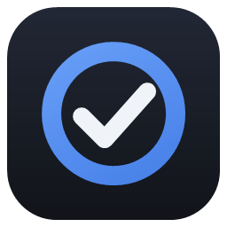
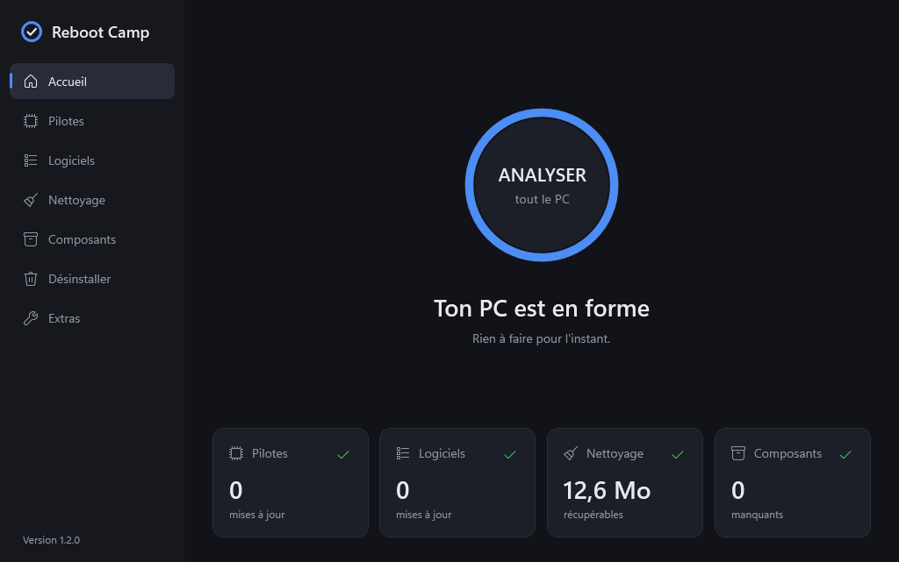

<div align="center">



# Reboot Camp

**L'entretien de ton PC Windows, sans rien qui tourne derrière ton dos.**

[](https://github.com/TomRolling/Reboot-Camp/releases/latest)
[](https://github.com/TomRolling/Reboot-Camp/releases)
[](LICENSE)


[**Télécharger RebootCamp.exe**](https://github.com/TomRolling/Reboot-Camp/releases/latest/download/RebootCamp.exe)

</div>

Pilotes, logiciels, nettoyage, désinstallation : Reboot Camp regroupe l'entretien courant d'un PC dans une seule fenêtre.
Chaque action part d'un bouton, montre ce qu'elle va faire avant de le faire, et dit clairement quand elle a fini.
L'interface est en français.



## Ce que ça fait

- **Accueil** : un bouton « Analyser tout le PC » enchaîne les vérifications et résume ce qu'il y a à regarder. Rien n'est
  modifié à cette étape.
- **Pilotes** : liste les pilotes, repère les périphériques en erreur, installe les mises à jour proposées par Windows
  Update et le dernier pilote graphique NVIDIA. Pour AMD et Intel, il lance l'outil officiel du fabricant.
- **Logiciels** : met à jour les programmes installés (navigateur, Discord, VLC…), ceux que tu coches. Quand une mise à
  jour ne peut pas passer, la raison est écrite sous le nom du logiciel, avec un bouton quand une solution existe.
- **Nettoyage** : calcule la place récupérable (fichiers temporaires, caches, corbeille…), montre le détail, et ne
  supprime que ce qui est coché.
- **Composants** : vérifie DirectX, Visual C++ et .NET, dont les jeux et logiciels ont besoin. Chacun est marqué manquant,
  à mettre à jour ou à jour.
- **Désinstaller** : retire un programme ou une application Windows par son désinstalleur officiel, puis propose de
  supprimer les dossiers et raccourcis qu'il a laissés. Des mentions en couleur signalent ce qu'il vaut mieux garder.
- **Extras** : programmes lancés au démarrage, infos sur le matériel, santé des disques, état de la sécurité, place
  occupée par dossier, outils de réparation de Windows, et un rapport à envoyer à la personne qui te dépanne.

Les listes affichent l'icône de chaque programme, lue sur ton PC.

## Installation

1. Télécharge [`RebootCamp.exe`](https://github.com/TomRolling/Reboot-Camp/releases/latest/download/RebootCamp.exe).
2. Lance-le. Il n'y a rien à installer : c'est un seul fichier, que tu peux ranger où tu veux (Bureau, clé USB…) et
   supprimer pour t'en débarrasser.

Il faut Windows 10 ou 11, en 64 bits.

**« Windows a protégé votre ordinateur »** — au premier lancement, Windows SmartScreen peut afficher cet écran bleu : le
fichier n'a pas de signature payante d'éditeur. Clique sur **Informations complémentaires**, puis sur **Exécuter quand
même**. L'écran ne revient pas aux lancements suivants.

Windows demande ensuite les **droits d'administrateur** : sans eux, impossible d'installer un pilote, de nettoyer les
dossiers de Windows ou de désinstaller un programme.

## Mises à jour

À chaque lancement, Reboot Camp demande à cette page GitHub s'il existe une version plus récente. Si c'est le cas, un
encart « Version … disponible » apparaît en bas de la barre latérale. Un clic sur **Mettre à jour** télécharge le nouveau
fichier, vérifie son empreinte, remplace l'ancien et relance l'appli. Rien n'est téléchargé sans ce clic.

## Bon à savoir

- **Rien ne tourne tout seul.** Pas de démarrage avec Windows, pas de service, pas d'icône près de l'horloge, aucune
  analyse au lancement. Fermer la fenêtre arrête tout.
- **Toujours un aperçu avant de supprimer.** Le nettoyage ne touche qu'une liste fixe de dossiers connus, garde les
  fichiers temporaires de moins de 24 h, et ne vide le cache d'un navigateur que s'il est fermé (jamais les mots de passe,
  les cookies ou l'historique).
- **Le registre de Windows n'est jamais nettoyé.** Il est lu, parce que c'est là que Windows tient la liste des programmes,
  mais Reboot Camp n'y supprime rien. Après une désinstallation, seuls des dossiers et des raccourcis sont proposés.
- **Le PC ne redémarre jamais sans ton accord.** Quand un redémarrage est nécessaire, une fenêtre propose « Redémarrer
  maintenant » ou « Plus tard ». Un installeur qui tente de redémarrer de lui-même est retenu, sauf s'il force l'arrêt de
  Windows, ce qu'aucune appli ne peut empêcher.
- **Un point de restauration est proposé** avant d'installer un pilote, de nettoyer ou de désinstaller.
- **Les pilotes viennent de sources officielles** : Windows Update, et nvidia.com pour le pilote graphique NVIDIA, dont la
  signature est vérifiée avant l'installation. Jamais de BIOS ni de firmware.
- **Les logiciels et composants passent par winget**, l'outil de Microsoft fourni avec Windows, qui vérifie l'empreinte de
  chaque installeur. Reboot Camp ne contourne jamais cette vérification.
- **Pas de pub, pas de collecte de données.** Les seuls échanges avec Internet : Windows Update, winget et nvidia.com quand
  tu le demandes, et la question posée à GitHub au lancement pour les mises à jour de l'appli.
- **Un journal** de ce que l'appli a fait est tenu dans `%LOCALAPPDATA%\RebootCamp\logs` ; le bouton « Ouvrir le journal »
  de l'onglet Extras y mène.

## Pour les développeurs

C# / WPF / .NET 10, MVVM avec CommunityToolkit.Mvvm.

```powershell
dotnet build
dotnet test                       # règles de sécurité du nettoyage et de la désinstallation, codes de winget…
dotnet run --project RebootCamp   # depuis un terminal administrateur
.\publier.ps1                     # fabrique le .exe autonome sur ton PC
```

| Où | Quoi |
| --- | --- |
| [`RebootCamp/Services/CleanupService.cs`](RebootCamp/Services/CleanupService.cs) | Le nettoyage et sa liste blanche de dossiers |
| [`RebootCamp/Services/Winget.cs`](RebootCamp/Services/Winget.cs) | Le seul endroit qui installe ou met à jour avec winget |
| [`RebootCamp/Services/UninstallService.cs`](RebootCamp/Services/UninstallService.cs) | La liste des programmes et leur désinstallation |
| [`RebootCamp/Services/LeftoverService.cs`](RebootCamp/Services/LeftoverService.cs) | La recherche des traces laissées sur le disque, et ses garde-fous |
| [`RebootCamp/Services/RestartService.cs`](RebootCamp/Services/RestartService.cs) | Tout ce qui touche au redémarrage du PC |
| [`RebootCamp/Services/UpdateService.cs`](RebootCamp/Services/UpdateService.cs) | La mise à jour de l'appli depuis les Releases |
| [`RebootCamp/ViewModels/`](RebootCamp/ViewModels/) | La logique de chaque onglet |
| [`RebootCamp/Views/`](RebootCamp/Views/) | Les écrans, en XAML |
| [`RebootCamp/Themes/`](RebootCamp/Themes/) | Les couleurs et les styles du thème sombre |
| [`RebootCamp.Tests/`](RebootCamp.Tests/) | Les tests automatiques, sur de faux dossiers : rien de réel n'est supprimé ni désinstallé |

**Publier une version** : il suffit d'un `git push` sur `main`. GitHub lance les tests, fabrique le `.exe` et crée la
Release ([`publication.yml`](.github/workflows/publication.yml)) ; si un test échoue, rien n'est publié. Les applis déjà
installées proposent la mise à jour à leur prochain lancement. Un push qui ne modifie que la documentation ne publie rien.

## Licence

[MIT](LICENSE) © Tom Rolling. Les icônes et les noms des programmes affichés dans l'appli appartiennent à leurs éditeurs.
